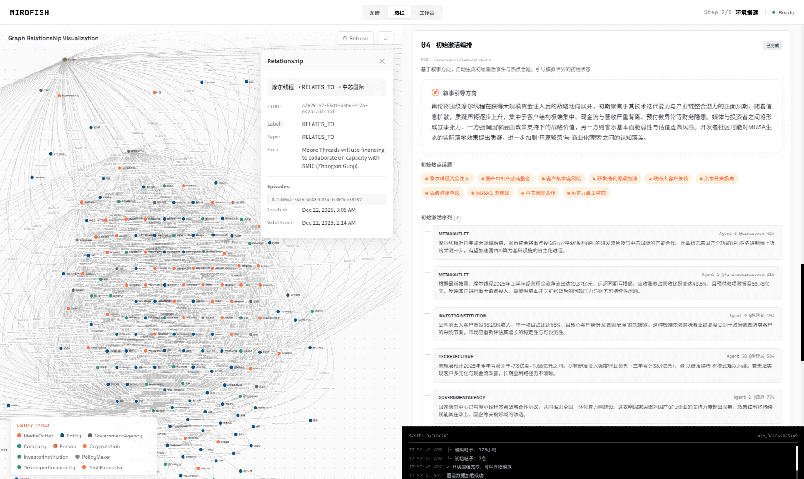
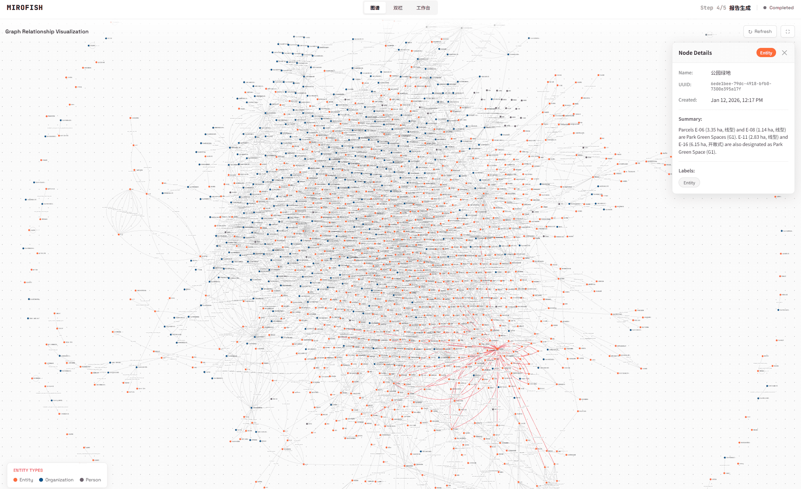

<div align="center">


# FuturesReport

A Futures Studies AI Multi-Agent Simulation Engine

[](https://hub.docker.com/)
[](./LICENSE)

[English](./README.md) | [简体中文](./README-ZH.md) | [繁體中文](./README-ZH-TW.md)

</div>

## ⚡ Overview

**FuturesReport** is a next-generation AI prediction engine powered by multi-agent technology. By extracting seed information from the real world (such as breaking news, policy drafts, or financial signals), it automatically constructs a high-fidelity parallel digital world. Within this space, thousands of intelligent agents with independent personalities, long-term memory, and behavioral logic freely interact and undergo social evolution. You can inject variables dynamically from a "God's-eye view" to precisely deduce future trajectories — **rehearse the future in a digital sandbox, and win decisions after countless simulations**.

> You only need to: Upload seed materials (data analysis reports or interesting novel stories) and describe your prediction requirements in natural language</br>
> FuturesReport will return: A detailed prediction report and a deeply interactive high-fidelity digital world

### Our Vision

FuturesReport is dedicated to creating a swarm intelligence mirror that maps reality. By capturing the collective emergence triggered by individual interactions, we break through the limitations of traditional prediction:

- **At the Macro Level**: We are a rehearsal laboratory for decision-makers, allowing policies and public relations to be tested at zero risk
- **At the Micro Level**: We are a creative sandbox for individual users — whether deducing novel endings or exploring imaginative scenarios, everything can be fun, playful, and accessible

From serious predictions to playful simulations, we let every "what if" see its outcome, making it possible to predict anything.

## 📸 Screenshots

<div align="center">
<table>
<tr>
<td></td>
<td></td>
</tr>
<tr>
<td></td>
<td></td>
</tr>
<tr>
<td></td>
<td></td>
</tr>
</table>
</div>

## 🎬 Demo Videos

### 1. Wuhan University Public Opinion Simulation

<div align="center">
<a href="https://www.bilibili.com/video/BV1VYBsBHEMY/" target="_blank"></a>

Click the image to watch the complete demo video for prediction using BettaFish-generated "Wuhan University Public Opinion Report"
</div>

### 2. Dream of the Red Chamber Lost Ending Simulation

<div align="center">
<a href="https://www.bilibili.com/video/BV1cPk3BBExq" target="_blank"></a>

Click the image to watch a deep prediction of the lost ending based on hundreds of thousands of words from the first 80 chapters of "Dream of the Red Chamber"
</div>

> **Financial Prediction**, **Political News Prediction** and more examples coming soon...

## 🔄 Workflow

1. **Graph Building**: Seed extraction & Individual/collective memory injection & GraphRAG construction
2. **Environment Setup**: Entity relationship extraction & Persona generation & Agent configuration injection
3. **Simulation**: Dual-platform parallel simulation & Auto-parse prediction requirements & Dynamic temporal memory updates
4. **Foresight Report** *(Futures Studies Powered)*: STEEP analysis & Causal Layered Analysis (CLA) & multi-scenario planning (possible/plausible/preferred futures) & emerging issues identification
5. **Deep Interaction**: Engage preferred futures — chat with any simulated agent & test scenario hypotheses & deep analysis with ReportAgent

## 🔭 Futures Studies Methodology

FuturesReport embeds academic **Futures Studies** methodology into its AI multi-agent simulation engine, transforming raw simulation output into structured, multi-futures analysis:

| Framework | Description |
|-----------|-------------|
| **Futures Cone** | Classifies outcomes into *Possible*, *Plausible*, and *Preferred* futures |
| **STEEP Analysis** | Systematic evaluation across Social, Technological, Environmental, Economic, and Political dimensions |
| **Causal Layered Analysis (CLA)** | Four-layer deep dive: Litany (surface events) → Systemic (structures) → Worldview (values) → Myth/Metaphor (deep culture) |
| **Multi-Scenario Planning** | Dual-variable matrix producing four scenario types: Best Case, Worst Case, Business as Usual, and Outlier (wild card) |
| **Emerging Issues** | Detects edge behaviors in simulation data as early signals of potential futures turning points |

> Terminology follows **Taiwan Futures Studies academic standards**, grounded in Sohail Inayatullah's CLA framework and standard Chinese academic translations used in Taiwan's futures studies scholarship.

## 🚀 Quick Start

### Option 1: Source Code Deployment (Recommended)

#### Prerequisites

| Tool | Version | Description | Check Installation |
|------|---------|-------------|-------------------|
| **Node.js** | 18+ | Frontend runtime, includes npm | `node -v` |
| **Python** | ≥3.11, ≤3.12 | Backend runtime | `python --version` |
| **uv** | Latest | Python package manager | `uv --version` |

#### 1. Configure Environment Variables

```bash
# Copy the example configuration file
cp .env.example .env

# Edit the .env file and fill in the required API keys
```

**Required Environment Variables:**

```env
# LLM API Configuration (supports any LLM API with OpenAI SDK format)
# Recommended: Alibaba Qwen-plus model via Bailian Platform: https://bailian.console.aliyun.com/
# High consumption, try simulations with fewer than 40 rounds first
LLM_API_KEY=your_api_key
LLM_BASE_URL=https://dashscope.aliyuncs.com/compatible-mode/v1
LLM_MODEL_NAME=qwen-plus

# FalkorDB (self-hosted graph engine, replaces Zep Cloud)
# LLM/embedding calls are BYOK — each user's own model settings, not a platform-wide key.
# Source deployment: run FalkorDB locally first, e.g.:
#   docker run -p 6379:6379 -p 3000:3000 -d falkordb/falkordb:latest
# Docker/Zeabur deployment: FALKORDB_HOST/PORT/PASSWORD are auto-injected, leave unset here.
# FALKORDB_HOST=localhost
# FALKORDB_PORT=6379
# FALKORDB_PASSWORD=
```

#### 2. Install Dependencies

```bash
# One-click installation of all dependencies (root + frontend + backend)
npm run setup:all
```

Or install step by step:

```bash
# Install Node dependencies (root + frontend)
npm run setup

# Install Python dependencies (backend, auto-creates virtual environment)
npm run setup:backend
```

#### 3. Start Services

```bash
# Start both frontend and backend (run from project root)
npm run dev
```

**Service URLs:**
- Frontend: `http://localhost:3000`
- Backend API: `http://localhost:5001`

**Start Individually:**

```bash
npm run backend   # Start backend only
npm run frontend  # Start frontend only
```

### Option 2: Docker Deployment

```bash
# 1. Configure environment variables (same as source deployment)
cp .env.example .env

# 2. Pull image and start
docker compose up -d
```

Reads `.env` from root directory by default, maps ports `3000 (frontend) / 5001 (backend)`

> Mirror address for faster pulling is provided as comments in `docker-compose.yml`, replace if needed.

### Option 3: Zeabur Deployment

Zeabur's container filesystem is **ephemeral** — every redeploy wipes the container's local disk. FuturesReport stores project files, simulation data, and reports under `backend/uploads/` by default, so without a persistent volume, a redeploy will delete that folder while database records (simulation history, reports) survive, leaving orphaned references like "Project not found: proj_xxx" when opening old simulation records.

To avoid this, configure persistent storage before deploying on Zeabur:

1. On your backend service, add a **Volume** (persistent volume) and mount it into the container, e.g. mount path `/data/uploads`.
2. Set the environment variable `UPLOAD_FOLDER=/data/uploads` on the backend service, so all project/simulation/report files are written to the mounted volume instead of the ephemeral container disk.
3. (Optional but recommended) Also point `USER_DATA_DIR` at a path under the same volume (e.g. `/data`) if you rely on the SQLite fallback instead of `DATABASE_URL`, so the database file persists across redeploys too.

Without this volume + `UPLOAD_FOLDER` configuration, project/simulation/report files will be lost on every redeploy even though database records remain — this is a known limitation of ephemeral container storage, not a bug in the application logic.

#### FalkorDB on Zeabur

The knowledge-graph engine (Graphiti + FalkorDB, replacing Zep Cloud) needs its own persistent service:

1. In your Zeabur project, add a service from the prebuilt **FalkorDB** template (or a generic Docker service using image `falkordb/falkordb:latest`, exposing port `6379`).
2. Attach a **Volume** to that service and mount it at `/data` — this is FalkorDB's actual persistence directory (confirmed against [docs.falkordb.com/operations/docker](https://docs.falkordb.com/operations/docker)), same requirement as the uploads volume above: without it, every redeploy wipes all built knowledge graphs.
3. Set a real password: on the FalkorDB service, set `REDIS_ARGS=--requirepass <your-password>`.
4. On the **backend** service, set:
   - `FALKORDB_HOST=<the FalkorDB service's internal hostname>` (Zeabur exposes inter-service DNS names, similar to how `DATABASE_URL` reaches the Postgres service)
   - `FALKORDB_PORT=6379`
   - `FALKORDB_PASSWORD=<the same password from step 3>`

LLM/embedding calls made against FalkorDB are BYOK (each user's own model settings, read from their account), so no platform-wide LLM key needs to be configured for the graph engine itself — only the FalkorDB connection details above.

> ⚠️ **Close the public port after testing.** If you temporarily expose FalkorDB's port to the public internet (e.g. Zeabur's "Networking → Public Domain/TCP Proxy") to run integration tests from your local machine, turn that exposure back off once testing is done. The backend should only ever reach FalkorDB over Zeabur's internal network — there's no reason for the graph database to be reachable from outside the project at all in normal operation.

## 📄 Acknowledgments

FuturesReport's simulation engine is powered by **[OASIS (Open Agent Social Interaction Simulations)](https://github.com/camel-ai/oasis)**. We sincerely thank the CAMEL-AI team for their open-source contributions!

## 📜 License

Licensed under the [GNU Affero General Public License v3.0](./LICENSE).
